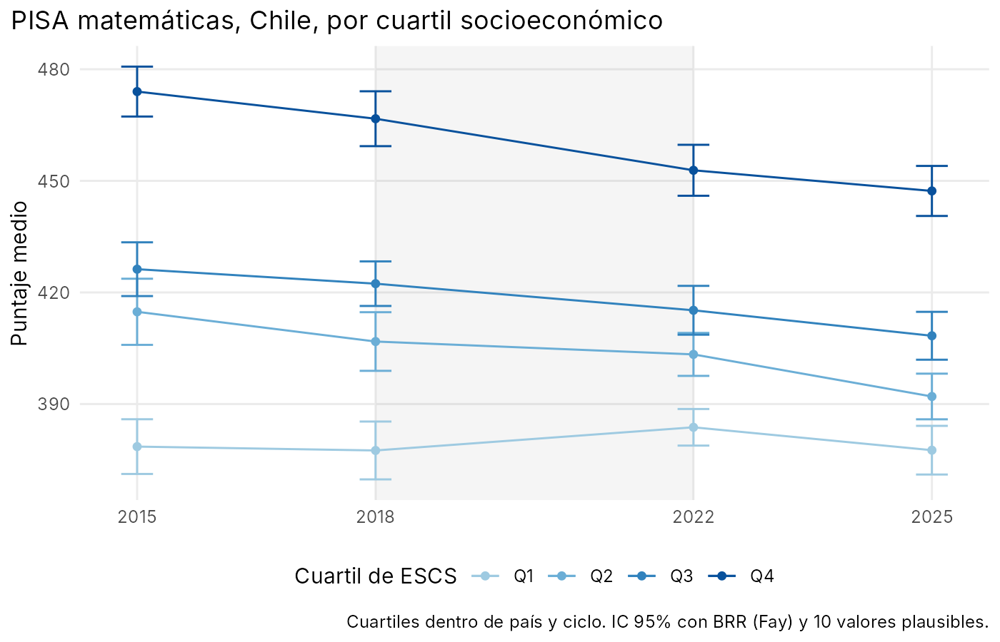
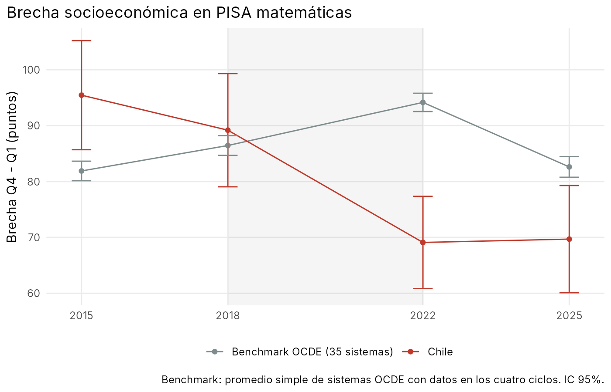
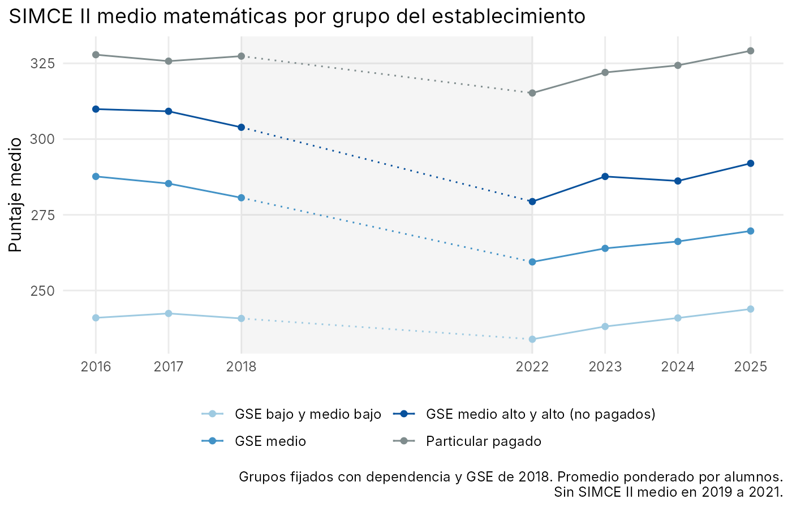

# Falling From the Top? La brecha socioeconómica de Chile en PISA y SIMCE, 2015-2025

Entre 2018 y 2022 la brecha en matemáticas entre los estudiantes de nivel socioeconómico alto y bajo se comprimió en Chile cerca de 20 puntos PISA, mientras en la OCDE se ampliaba. La compresión no vino de una mejora en la parte baja de la distribución, sino de una caída en la parte alta. Este repositorio documenta ese hecho con microdatos PISA y lo valida con el censo SIMCE de II medio, y descarta varias explicaciones candidatas.

Todo el código está en R y se puede correr de punta a punta con los datos públicos de la OCDE, la Agencia de Calidad de la Educación y el Mineduc.







## Resultados principales

- PISA matemáticas, 2018-2022: la brecha entre el cuartil alto y el bajo de ESCS cae 20,1 puntos (e.e. 6,7) en Chile y sube 7,7 en un benchmark de 35 sistemas OCDE. La triple diferencia es de -27,8 (e.e. 6,8) y Chile es el sistema con mayor compresión de los 36. El cuartil alto cae 13,9 puntos y el bajo sube 6,2.
- La compresión ocurre sobre todo dentro de cada dependencia administrativa (16,3 de los 20,1 puntos), no por cambios en la composición de los cuartiles.
- SIMCE II medio, con un panel balanceado de colegios y grupos fijados en 2018, muestra lo mismo: la brecha entre los colegios de GSE medio alto y alto no pagados y los de GSE bajo y medio bajo se comprime 17,5 puntos (e.e. 1,7), frente a 5,2 en la tendencia previa 2016-2018. Entre 2022 y 2025 todos los grupos recuperan de forma pareja y la brecha no vuelve a abrirse.
- El gradiente se mantiene con efectos fijos de comuna (18,6; e.e. 1,9), así que ningún factor comunal (cuarentenas, conectividad, mercado laboral local) lo explica.
- No lo explican la presencialidad 2020-2021, el bienestar socioemocional medido por los IDPS, la caída de cobertura de SIMCE (con cotas de selección tipo Lee), los liceos de alta exigencia ni la rotación docente. Cerca de 60% del gradiente pasa por la efectividad previa del colegio (Categoría de Desempeño): los colegios más efectivos antes de la pandemia perdieron más, más allá de la reversión a la media que muestra el placebo.

## Datos y método

PISA 2015, 2018, 2022 y 2025 (microdatos de estudiantes y escuelas, OCDE).

- Grupos: cuartiles de ESCS publicado dentro de país y ciclo, con 25% del peso final cada uno, recalculados con cada peso replicado. Desempate aleatorio con semilla fija.
- Errores estándar: 80 pesos replicados BRR con factor de Fay 0,5 y 10 valores plausibles combinados con las reglas de Rubin. El motor está en `R/lib_survey.R` y se prueba con datos simulados en `tests/test_engine.R`.
- Cambios entre ciclos como muestras independientes. Se reporta estimador, error estándar, intervalo de confianza y efecto mínimo detectable (bilateral al 5%, potencia de 80%).
- Benchmark: sistemas OCDE en 2025 con ESCS y puntajes en los cuatro ciclos, excluyendo Chile, con promedio simple (35 sistemas, `output/tables/benchmark_countries.csv`).
- Validación: las 12 cifras de control de Cobreros et al. (2026) para Chile se reproducen con diferencias de 0,15 puntos o menos (`output/tables/validation_cobreros.csv`).

La especificación principal se fijó en `config.R` antes de mirar resultados.

SIMCE II medio 2016-2025 (bases públicas por establecimiento, Agencia de Calidad). Panel balanceado de colegios por transición, grupos fijados con dependencia y GSE de 2018 para evitar que la reclasificación se confunda con el cambio de puntaje, ponderación por alumnos evaluados y errores robustos por colegio o agrupados por comuna. SIMCE es censal, así que estos errores reflejan variación entre colegios y no error muestral.

Fuentes complementarias por RBD: estado de apertura de establecimientos 2020-2021 y matrícula por curso (datos abiertos Mineduc), IDPS y Categorías de Desempeño (Agencia), Directorio Docentes 2016-2022 (Mineduc).

## Resultados en detalle

### PISA

- Lectura muestra el mismo signo (triple diferencia -17,0; e.e. 7,2), pero la brecha chilena cae solo 10,9 (e.e. 7,2). En ciencias la brecha de Chile casi no se mueve (-2,3) y la triple diferencia (-13,2) viene del alza del benchmark. El hallazgo robusto es el de matemáticas.
- 2022-2025: la brecha de Chile no se mueve (+0,6). La triple diferencia positiva refleja el artefacto del ESCS publicado en el benchmark documentado por Cobreros et al., no un cambio chileno.
- ESCS faltante: sube de 1,8% a 9,7% del peso, y esos estudiantes rinden cerca de 38 puntos menos que el resto. Una cota gruesa del sesgo sobre el cuartil bajo es de 3 puntos o menos, insuficiente para explicar la compresión.
- Dependencia: `SCHLTYPE` no sirve en 2025 (la proporción de particular pagado salta a 17,7%), así que la dependencia se obtiene de los estratos explícitos de muestreo, que dan una proporción estable (8,1%, 8,8%, 8,3%, 9,9%). De la caída de 20,1 en la brecha, 16,3 (e.e. 6,5) ocurre dentro de cada dependencia y 3,8 (e.e. 1,7) por la mezcla de dependencias de cada cuartil. La caída del cuartil alto dentro de dependencia (-11,9; e.e. 5,0) se reparte entre subvencionados (-8,5) y particulares pagados (-3,7); el aporte de los públicos es nulo.
- Pantallas: no hay ítems comparables entre 2018 y 2022. En 2022 y 2025 el cuartil alto usa unas 0,6 horas diarias más de pantallas recreativas, pero no reporta más distracción, y la parte de la brecha atribuible es cercana a cero.

### SIMCE II medio

Cambio en matemáticas, panel balanceado, 2018-2022 (e.e.):

| Grupo del establecimiento (2018) | 2016-2018 | 2018-2022 | 2022-2025 |
|---|---|---|---|
| GSE bajo y medio bajo | -0,9 (0,5) | -7,3 (0,6) | +10,6 (0,5) |
| GSE medio | -6,2 (0,9) | -21,4 (1,0) | +10,4 (0,9) |
| GSE medio alto y alto, no pagados | -6,1 (1,0) | -24,9 (1,6) | +12,5 (1,6) |
| Particular pagado | -2,1 (0,9) | -13,2 (1,2) | +14,7 (1,1) |
| Brecha medio alto y alto menos bajo | -5,2 (1,1) | -17,5 (1,7) | +1,9 (1,7) |

- Tendencia previa: restando la tendencia 2016-2018 extrapolada linealmente, la compresión 2018-2022 que la excede es de 7,4 puntos (e.e. 2,7); con la mitad de la tendencia, 12,5 (1,9).
- Dentro de comuna: la ventaja de los colegios de GSE bajo y medio bajo es de 17,5 puntos (e.e. 1,4); con ruralidad y Región Metropolitana, 18,1 (1,5); con efectos fijos de comuna, 18,6 (1,9).
- Antecedente: el Informe de Resultados Educativos SIMCE 2022 de la Agencia ya reporta la caída diferencial por GSE con datos transversales. Lo que agrega este repositorio es el panel con GSE fijo, la comparación con PISA y la OCDE, el resultado dentro de comuna, la tendencia previa y los mecanismos descartados.

### Mecanismos descartados

- Presencialidad (estado de apertura diario autorreportado, oct-dic 2020 y mar-dic 2021). Los colegios de GSE alto abrieron más, no menos (60,2% de los días en 2021 frente a 52,6% en GSE bajo). Con efectos fijos de comuna, la apertura explica 0,3 puntos (e.e. 0,3, bootstrap de comunas) del gradiente según una descomposición de Gelbach. Además, la apertura de 2021 predice el cambio 2016-2018, así que está asociada a tendencias previas.
- IDPS de autoestima académica y clima de convivencia: cambios por grupo de menos de 1 punto (escala 0-100) entre 2018 y 2022.
- Cobertura (evaluados sobre matriculados en II medio). Cayó algo más en los colegios de GSE alto (89,7% a 82,0%) que en los de GSE bajo (82,0% a 76,1%). Controlando el cambio de cobertura, la ventaja de GSE bajo es 18,5 (2,0); con el peor caso de selección en todos los colegios, 18,3 a 18,4; con el peor caso extremo aplicado solo a los colegios de GSE bajo, 9,8 a 11,6 (e.e. 2,0). La selección no explica la compresión.
- Liceos de alta exigencia (los 21 de la RM con esa categoría en 2019). Caen fuerte, pero suman unos 4.000 de 190.000 alumnos: sin ellos, el cambio del grupo de GSE medio alto y alto pasa de -24,9 a -23,6.
- Rotación docente (Directorio Docentes, docentes de aula de media). La retención a dos años subió durante la pandemia en GSE bajo (0,68 a 0,73) y quedó igual en GSE alto. Agregar rotación, edad y experiencia docente no cambia la ventaja de GSE bajo (7,7 a 7,0) ni el coeficiente de los colegios de categoría Alto. Placebos nulos.

### Efectividad previa

Con la Categoría de Desempeño 2017 (construida con datos hasta 2016, sin ruido compartido con 2018 ni 2022) y efectos fijos de comuna, relativo a la categoría Medio: Alto -3,8 (1,2) en el placebo 2016-2018 y -12,5 (1,8) en 2018-2022. La caída extra de los colegios Alto va más allá de la reversión a la media del placebo, en línea con la hipótesis de Kuzmanic et al. Al controlar por la categoría, la ventaja de GSE bajo baja de 18,6 a 7,7 (1,9). Las bases públicas traen solo la categoría y no el índice continuo, así que no permiten un diseño de regresión discontinua.

## Estructura

```
config.R                     parámetros, archivos, especificación y valores de validación
run_all.R                    corre todo el análisis
R/lib_survey.R               motor de estimación: BRR (Fay) + valores plausibles (Rubin)
R/01_extract.R               lee los .sav de la OCDE y guarda extractos .rds
R/02_chile_quartiles.R       Chile por cuartil de ESCS, brecha y cambios entre ciclos
R/03_missing_escs.R          proporción y puntaje de estudiantes sin ESCS
R/04_school_type.R           por tipo de colegio con SCHLTYPE (solo referencia, ver 09)
R/05_benchmark.R             panel balanceado OCDE y triple diferencia
R/06_validate.R              comparación con Cobreros et al. (2026)
R/07_figures.R               figuras en PDF
R/08_strata.R                estratos de muestreo de Chile frente a SCHLTYPE
R/09_dependencia.R           dependencia desde STRATUM y descomposición dentro/composición
R/10_simce.R                 SIMCE II medio por establecimiento, 2016-2025
R/11_alta_exigencia.R        liceos de alta exigencia (RM, 2019) frente al resto
R/12_gradiente_comuna.R      gradiente con ruralidad, RM y efectos fijos de comuna
R/13_mecanismos.R            presencialidad, IDPS y brecha neta de la tendencia previa
R/14_cobertura.R             cobertura SIMCE y cotas de selección
R/15_categoria_desempeno.R   efectividad previa con placebo de regresión a la media
R/16_docentes.R              rotación y perfil docente
R/17_pisa_pantallas_explorar.R, R/18_pisa_pantallas.R   pantallas y distracción en PISA
R/figuras_readme.R           figuras PNG de este README
tests/test_engine.R          prueba del motor con datos simulados
output/tables/               resultados en CSV
output/figures/              figuras
data/raw/, data/interim/     datos originales y extractos (no versionados)
```

## Cómo reproducir

Requisitos: R 4.1 o superior y los paquetes `data.table`, `haven` y `ggplot2`.

```
Rscript tests/test_engine.R    # verifica el motor, no requiere datos
Rscript run_all.R              # análisis completo
Rscript run_all.R 10           # solo la parte SIMCE, sin los microdatos PISA
```

Datos que hay que descargar y dejar en `data/raw/`:

| Carpeta | Fuente | Uso |
|---|---|---|
| `data/raw/` | OCDE, PISA Database 2015, 2018, 2022 y 2025, archivos SPSS de estudiantes y escuelas, con los nombres de `config.R` ([descarga](https://www.oecd.org/en/about/programmes/pisa/pisa-data.html)) | 01 a 09, 17, 18 |
| `simce/rbd/` | Agencia de Calidad, SIMCE II medio por establecimiento, `simce2m<año>_rbd.csv` ([portal](https://informacionestadistica.agenciaeducacion.cl)) | 10 a 16 |
| `idps/` | Agencia de Calidad, IDPS II medio por establecimiento 2016, 2017, 2018 y 2022 | 13 |
| `categorias/` | Agencia de Calidad, Categorías de Desempeño de media 2017-2019, consolidadas en `cdm_media.csv` (`year`, `rbd`, `categoria`) | 15, 16 |
| `apertura/` | Mineduc, Estado de apertura de establecimientos, oct 2020 a dic 2021 ([datos abiertos](https://datosabiertos.mineduc.cl)) | 13 |
| `matricula/` | Mineduc, Resumen de matrícula por curso 2016, 2018 y 2022; 14 construye `matricula_2m.csv` | 14 |
| `docentes/` | Mineduc, Cargos docentes 2016-2022, consolidados en `docentes_media.csv` (`year`, `rbd`, `mrun`, `edad`, `exp`, `horas`) | 16 |

Cada archivo PISA de estudiantes pesa cerca de 2 GB. El paso 1 lee solo las columnas necesarias, pero conviene tener al menos 8 GB de RAM. La parte SIMCE corre en pocos minutos.

## Limitaciones y pendientes

- Los errores de enlace entre ciclos PISA no están incorporados todavía (`LINK_ERROR` en `config.R`). Solo afectan los cambios de nivel, no las brechas dentro de un ciclo.
- El ESCS armonizado entre ciclos (Cobreros et al.) queda como ejercicio de robustez pendiente.
- La consolidación de `cdm_media.csv` y `docentes_media.csv` desde las descargas originales todavía no está en un script.
- En 11_alta_exigencia.R, el RBD de dos de los 21 liceos se asignó por nombre y no está confirmado con una fuente oficial.
- Todo lo anterior es descriptivo: documenta dónde ocurrió la compresión y qué no la explica, pero no identifica su causa. Una segunda etapa del proyecto, con diseño causal, está en desarrollo y no forma parte de este repositorio.

## Referencias

- Agencia de Calidad de la Educación (2023). Informe de Resultados Educativos SIMCE 2022, Tomo I.
- Cobreros, L., Colomer, M., Correig-Fraga, E., Gortazar, L. y Sayol, I. (2026). Explaining the learning decline in PISA 2025 by socioeconomic quartiles through methodological changes. Working paper, EsadeEcPol, World Bank e Innovamat Research Lab. https://github.com/Innovamat-Technology/pisa_2025
- Gelbach, J. B. (2016). When do covariates matter? And which ones, and how much? Journal of Labor Economics, 34(2), 509-543.
- Lee, D. S. (2009). Training, wages, and sample selection: Estimating sharp bounds on treatment effects. Review of Economic Studies, 76(3), 1071-1102.
- OECD (2016, 2019, 2023, 2026). PISA Database 2015, 2018, 2022 y 2025. OECD, París.

## Autor

Eduardo Munizaga, Facultad de Economía y Negocios, Universidad de Chile. El código se distribuye con licencia MIT; los datos pertenecen a sus respectivas instituciones y su uso está sujeto a sus términos.
